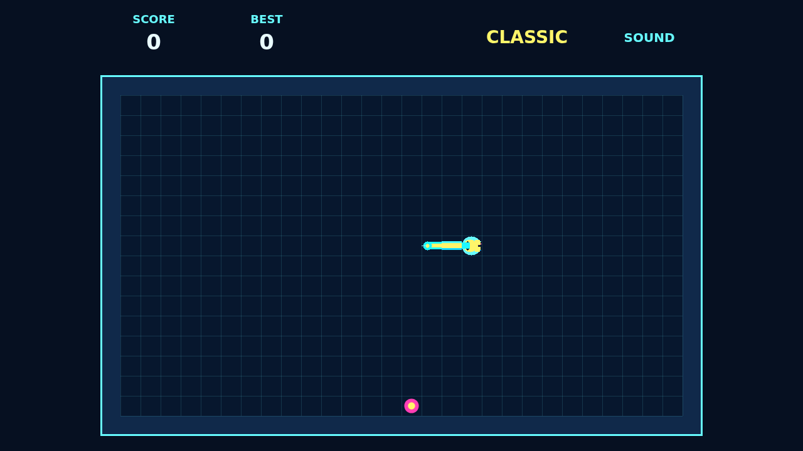

# Coil

Coil is a neon grid serpent about staying calm while the board gets tighter.
The snake never stops, and each turn lands on the next tick, so every pellet is
a little route-planning problem.

Eat pellets to grow longer and score points. The wall border and your own body
are fatal, but a clean line lets you skim through narrow gaps and chase your
tail across the grid.

The combo window is the pressure. Grab pellets quickly and the multiplier climbs
toward `x5`; hesitate and it falls back to one. A strong run feels like tracing
one bright circuit through the whole board.
